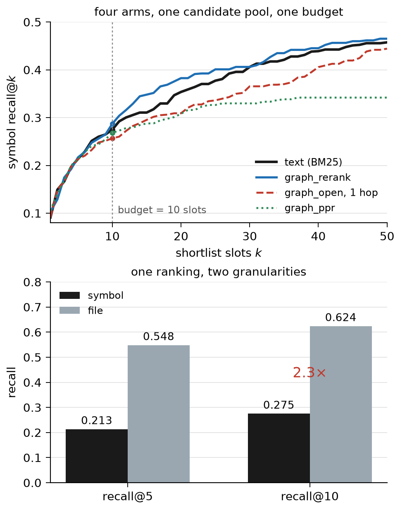

# Beyond File Hits: Candidate Coverage and Graph Utility in Code Localization

A controlled study of symbol retrieval for coding agents on SWE-bench Lite and the full test split.

**[Paper (PDF)](paper/submission.pdf)** · Kaggle Gemma 4 Developer Agent Paper Track, 2026



## What the study measures

We distinguish candidate coverage, selection within a shortlist, and the granularity at which a hit is credited. The contribution is an audited empirical diagnosis of these mechanisms, not a new localization algorithm or the first function-level evaluation.

- **One ranking, two scores.** On 290 scorable Lite tasks, the first ten symbols cover 62.4% of gold files and 27.5% of gold symbols. File recall scores these same ten symbol slots, not ten distinct retrieved files.
- **A small positive graph effect.** Seven graph variants show no statistically significant symbol improvement over BM25 on Lite. Graph reranking gains +2.2 percentage points on 2,232 tasks; in an earlier 16-feature ranker ablation, graph features added +2.7 points (a different experiment from the +1.66-point frozen-fusion ablation reported below). These results do not establish that graphs are ineffective.
- **Reach and displacement differ.** In the Lite setup, the 200-candidate pool's oracle recall is 0.600, rising to 0.630 with neighbours. Sparse useful neighbours and displacement of existing hits limit net gains.
- **Index content changes the comparison.** Adding each candidate's body raises full-scale BM25 symbol recall from 0.248 to 0.286. The granularity ratio is a property of the retrieval setup, not a constant.
- **Dense and explicit scores complement each other.** On the same 200 candidates, the held-out 16-feature ranker reaches 0.361 symbol / 0.643 file recall; adding a frozen dense score reaches **0.447 / 0.727**. Dense inputs include body text, unlike the metadata BM25 baseline. Retraining this fusion without three topology features lowers symbol recall to **0.430**; their +1.66-point contribution has a repository interval of +0.66 to +2.42 points.
- **Scale can change the conclusion.** A hand-written evidence override gains 2.9 points on Lite but −0.2 points at full scale. Lite is included in the full split; sample composition and training size both change, so this is not independent replication or a causal training-size experiment.

All principal comparisons use ten slots; a separate repricing charges the text each presentation makes an agent read, measured in bge-small tokens (§5). The 16× file/definition source-length ratio is not a measured agent-cost saving. We evaluate retrieval, not resolved rate.

## Topology-control follow-up (November 1)

All 2,232 tasks now have a fixed-pool, seed-retaining comparison across metadata,
body BM25, and frozen dense ranking. Real graphs beat degree/file-constrained
rewiring by 2.14 / 0.90 / 1.76 points; only metadata and dense survive the
five-test Holm correction (body Holm p = 0.1787). Gains over each original
ranking are 2.19 / -0.01 / 0.64 points. The representation interactions do not survive correction.

This distinguishes topology carrying information from a simple reranking policy
improving retrieval. It does not show that stronger text makes graphs redundant.
Historical Lite seed handling and dense rounding ties differ; both are disclosed.

[Results and figure](docs/graph-control-results.md) ·
[Frozen protocol](docs/graph-control-protocol.md) ·
[Interpretation](docs/novelty-review.md#graph-control-interpretation) ·
[Reproduce](docs/reproduction.md#graph-control-reproduction)

```bash
uv run python tools/audit_graph_controls.py
uv run python tools/analyse_graph_controls.py
```

## Recompute the reported metrics

```bash
uv venv --python 3.12 .venv
uv sync --frozen
uv run python tools/audit_numbers.py
uv run python -m unittest discover -s tests
```

The numerical audit recomputes metrics from released outputs; it does not independently rerun every retrieval or training step. It needs no GPU or model weights. Full input preparation, repository folds, encoder revision, and rerun commands are in [docs/reproduction.md](docs/reproduction.md).

## Resource and scope

| path | contents |
| --- | --- |
| `experiments/` | patch-derived targets, AST graph builder, BM25, snapshot readers |
| `tools/` | graph interventions, learned ranking, diagnostics, audits, publication build |
| `data/` | tracked gold labels and per-task experiment outputs |
| `paper/` | manuscript sources, PDF, figures and writeup variants |
| [`artifacts/`](artifacts/README.md) | historical outputs consolidated with per-file hashes and original paths |
| [`docs/`](docs/README.md) | documentation index: current work, reproducibility, supporting experiments and archives |

An independent gold derivation matches 279 of 300 Lite answer keys exactly; rescoring with repaired targets changes recall by at most 0.7 points. Details: [docs/gold-audit.md](docs/gold-audit.md).

The graph results concern one heuristic Python graph and static retrieval. Existing work already studies function-level localization and graph-tool ablations, including a closely related October 2026 study. Our [novelty review](docs/novelty-review.md) records the overlap and the completed follow-up distinguishing topology signal from intervention value under stronger representations.

## Cite

> Beyond File Hits: Candidate Coverage and Graph Utility in Code Localization. Kaggle Gemma 4 Developer Agent Paper Track submission, 2026.
> <https://github.com/BugMaker-Pro/kaggleGemma-4>

Submission status and local build notes: [docs/status.md](docs/status.md).
