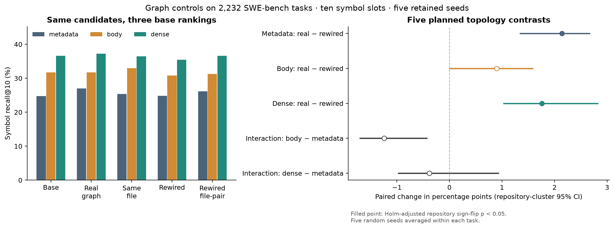

# 图拓扑对照与检索表示交互：实验结果

完整评估 **2232 个任务、12 个仓库**。协议见 `docs/graph-control-protocol.md`。

同一原始候选池、保留前五个种子、十个符号位置。随机图五个种子先在任务内平均。
正文 BM25 使用全仓库语料统计，但只重排共同候选池；没有重新训练模型或扩大候选集。
dense 是冻结编码器单独排序；不采用已包含图特征的 44.7% 融合排序器作为无图底座，以免循环比较。

## 绝对召回率

| 排序表示 | 干预 | 符号 recall@10 | 文件 recall@10 | 平均新增金标 | 平均丢失金标 |
| --- | --- | ---: | ---: | ---: | ---: |
| metadata | base | 0.2479 | 0.5643 | 0.0000 | 0.0000 |
| metadata | real | 0.2698 | 0.5644 | 0.0856 | 0.0493 |
| metadata | file | 0.2534 | 0.4712 | 0.0762 | 0.0475 |
| metadata | rewired | 0.2484 | 0.5556 | 0.0662 | 0.0615 |
| metadata | rewired_pair | 0.2612 | 0.5642 | 0.0780 | 0.0540 |
| body | base | 0.3171 | 0.6305 | 0.0000 | 0.0000 |
| body | real | 0.3170 | 0.6207 | 0.0623 | 0.0538 |
| body | file | 0.3295 | 0.5277 | 0.0977 | 0.0511 |
| body | rewired | 0.3080 | 0.6153 | 0.0608 | 0.0668 |
| body | rewired_pair | 0.3128 | 0.6189 | 0.0623 | 0.0599 |
| dense | base | 0.3659 | 0.6931 | 0.0000 | 0.0000 |
| dense | real | 0.3723 | 0.6901 | 0.0703 | 0.0542 |
| dense | file | 0.3645 | 0.5981 | 0.0663 | 0.0529 |
| dense | rewired | 0.3547 | 0.6816 | 0.0570 | 0.0723 |
| dense | rewired_pair | 0.3658 | 0.6892 | 0.0673 | 0.0613 |

### 保留种子的剩余改善空间（事后描述，非新增检验）

| 表示 | 前五种子金标 recall | 保留种子后的 oracle@10 | 相对原排序最大可改善空间 | 仍可通过重排改善的任务 |
| --- | ---: | ---: | ---: | ---: |
| metadata | 0.1863 | 0.5676 | 0.3197 | 1069 |
| body | 0.2382 | 0.5679 | 0.2508 | 890 |
| dense | 0.2866 | 0.5683 | 0.2024 | 741 |

表示更强时，种子可能已包含更多答案；交互效应也可能受剩余改善空间影响。不能将交互直接归因为正文补偿了图信息。

## 预先指定的五个主要对比

效应与区间单位为百分点；区间为仓库 cluster bootstrap 的逐项区间（未作同时覆盖校正）。p 值为穷举仓库符号翻转，Holm 同时校正五项。

| 对比 | 效应 [95% CI] | 仓库检验 p | Holm p | 任务胜/负 | 正向仓库数 |
| --- | ---: | ---: | ---: | ---: | ---: |
| metadata:real-rewired | +2.14 [+1.34, +2.66] | 0.0034 | 0.0137 | 183/154 | 10/12 |
| body:real-rewired | +0.90 [+0.01, +1.58] | 0.0894 | 0.1787 | 145/147 | 9/12 |
| dense:real-rewired | +1.76 [+1.04, +2.82] | 0.0010 | 0.0049 | 162/112 | 11/12 |
| interaction:body-metadata | -1.24 [-1.70, -0.43] | 0.0420 | 0.1260 | 192/236 | 3/12 |
| interaction:dense-metadata | -0.38 [-0.97, +0.93] | 0.5981 | 0.5981 | 228/207 | 6/12 |

交互 =（新表示下真实图 − 随机图）−（metadata 下真实图 − 随机图）。负值表示条件拓扑优势缩小，不自动证明因果补偿机制。

## 次要对比（探索性，不做主结论筛选）

| 对比 | 效应 [95% CI] | 仓库检验 p（未校正） | 任务胜/负 |
| --- | ---: | ---: | ---: |
| metadata:real-base | +2.19 [+1.27, +2.66] | 0.0146 | 169/90 |
| metadata:real-file | +1.64 [-0.72, +3.29] | 0.3047 | 180/151 |
| metadata:real-rewired_pair | +0.86 [+0.46, +1.22] | 0.0098 | 105/81 |
| body:real-base | -0.01 [-0.97, +1.02] | 0.9707 | 120/106 |
| body:real-file | -1.26 [-2.89, -0.24] | 0.0552 | 129/202 |
| body:real-rewired_pair | +0.41 [-0.15, +0.94] | 0.2212 | 90/83 |
| dense:real-base | +0.64 [+0.03, +1.60] | 0.0693 | 131/105 |
| dense:real-file | +0.78 [-0.72, +1.99] | 0.3052 | 167/155 |
| dense:real-rewired_pair | +0.65 [+0.23, +1.48] | 0.0132 | 95/58 |

## 随机对照是否真正改变图

共同候选图中位边数 33.0；1 个任务没有候选池内边。

| 对照 | 原始边被替换比例均值/中位数 | 完全没有接受交换的任务 | 最终边未变化的任务 | 替换比例 ≥25% 任务 |
| --- | ---: | ---: | ---: | ---: |
| rewired | 0.542/0.571 | 28 | 28 | 2094 |
| rewired_pair | 0.190/0.171 | 273 | 345 | 708 |

### rewired 的可移动子集（图属性筛选，探索性）

| 表示 | 真实图减对照 [95% CI]，百分点 | 五个随机种子的全量召回范围 | 至少一次种子可达集合变化的任务 |
| --- | ---: | ---: | ---: |
| metadata | +2.27 [+1.40, +2.85] | 0.2470–0.2506 | 1705 |
| body | +0.98 [+0.01, +1.73] | 0.3035–0.3133 | 1729 |
| dense | +1.82 [+1.04, +2.90] | 0.3518–0.3580 | 1691 |

### rewired_pair 的可移动子集（图属性筛选，探索性）

| 表示 | 真实图减对照 [95% CI]，百分点 | 五个随机种子的全量召回范围 | 至少一次种子可达集合变化的任务 |
| --- | ---: | ---: | ---: |
| metadata | +1.35 [+0.67, +2.08] | 0.2603–0.2617 | 1164 |
| body | +0.65 [-0.38, +1.33] | 0.3103–0.3144 | 1114 |
| dense | +1.20 [+0.32, +2.71] | 0.3644–0.3671 | 1041 |

## Lite 描述性复核（属于全量，不独立）

| 表示 | 原排序 | 真实图 | 同文件 | 随机图 | 严格随机图 |
| --- | ---: | ---: | ---: | ---: | ---: |
| metadata | 0.2750 | 0.3044 | 0.2986 | 0.2674 | 0.2935 |
| body | 0.3699 | 0.3698 | 0.3770 | 0.3622 | 0.3640 |
| dense | 0.3777 | 0.3990 | 0.3908 | 0.3716 | 0.3898 |

## Dense 并列规则敏感性（事后审计发现，主协议未变）

原协议保留 encoder 保存的候选顺序；历史融合脚本改为按四舍五入分数排序、候选索引打破并列。共有 2224 个任务的完整顺序不同，18 个任务的前十成员不同，19 个任务的前五成员不同。

只有 django__django-11019 的 dense 基线符号 recall 因边界并列而变化（0 对 1/3），因此全量主实验为 0.3659，历史规则为 0.3661。两种规则均完整报告，不替换主实验。

| 主要对比（历史并列规则） | 效应，百分点 | Holm p |
| --- | ---: | ---: |
| metadata:real-rewired | +2.14 | 0.0137 |
| body:real-rewired | +0.90 | 0.1787 |
| dense:real-rewired | +1.75 | 0.0049 |
| interaction:body-metadata | -1.24 | 0.1260 |
| interaction:dense-metadata | -0.39 | 0.5938 |

这项敏感性检查没有改变五个主要对比的显著性判断。

## 推断边界

- 这些比较识别的是给定候选池与一跳排序规则下的条件效应。不能外推为多轮 agent 或图扩展的结论。
- 随机交换保持每个节点的文件内/跨文件度数；严格版本还保持每个节点到各文件的度数。候选池外边不变。
- 没有证明图交换链混合充分，也不声称均匀抽样。高度受限或不可移动的零差异不能证明拓扑不重要。
- 同文件控制促进的候选数可能不同，不能仅凭它优于真实图就认定图没有独立信息。
- 仓库符号翻转需要零假设下效果符号可交换/对称；十二个仓库仍限制泛化与精度。区间未对图随机种子的有限抽样做嵌套重采样；另列五种子的结果范围。
- 本研究是在已探索的基准上新增对照，不是独立外部验证。所有主要比较与随机种子在新结果检查前固定。

完整逐任务输出、投影上下文、输入哈希及各仓库效应分别保存于 `data/graph_controls*.jsonl`、manifest 和 summary JSON。
