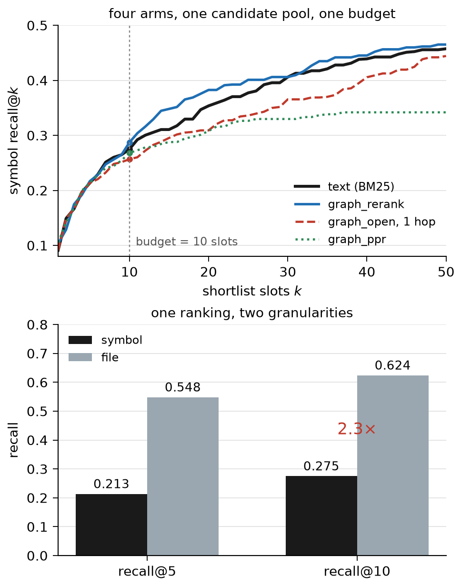

# Paper draft (v13: topology controls and representation interaction)

> Target: **3,000 words**, Kaggle Writeup, deadline 2026-11-13 07:59 (UTC+8).
> Mandatory sections (missing any = ineligible): Title + Subtitle, Abstract, Introduction, Research description (methods & experiments), Related works & citations.
> Protocol and changelog: [docs/archive/history.md#paper-topic](../docs/archive/history.md#paper-topic). Official rules: [docs/competition/kaggle-paper-track-raw.md](../docs/competition/kaggle-paper-track-raw.md).
>
> **Draft status**: revised on 2026-11-08. Counts and publication checks are generated from the submission sources; numerical claims are checked by `tools/audit_numbers.py`. Novelty assessment: [docs/novelty-review.md](../docs/novelty-review.md).

---

## Title

**Beyond File Hits: Candidate Coverage and Graph Utility in Code Localization**

Subtitle: *A controlled retrieval study of graph reach, shortlist displacement, and index content on SWE-bench Lite and the full test split*

---

## Abstract

Real repository topology carries information that degree- and file-matched random graphs lack, yet the promotion rule used to exploit it adds little over strong text. We hold candidate pools fixed and compare real edges with constrained rewiring under metadata, body, and dense rankings at 2,232 tasks. Real graphs beat rewiring by **2.14, 0.90, and 1.76 points**; metadata and dense contrasts survive repository-level testing with Holm correction. Yet gains over each original ranking are **2.19, −0.01, and 0.64 points**, so topology signal and useful intervention differ, and representation interactions do not survive correction. The patch-derived answer key is independently audited: one ranking recovers **62.4%** of gold files but **27.5%** of gold symbols on 290 scorable Lite tasks. A learned ranker plus dense scores reaches **44.7%** symbol and **72.7%** file recall; removing topology features lowers symbol recall to **43.0%**. We release targets, graph controls, rankings, and audits. Results characterize static, fixed-slot retrieval, not general graph-guided agent effectiveness.

---

## 1. Introduction

A coding agent must find the definition to edit, not merely the file that contains it: Lite gold files contain a median 48 definitions, and the median file/definition length ratio is 16.1. We ask whether repository topology helps a fixed-budget retriever, and whether the usual way of using it improves the shortlist at all. Prior work evaluates functions and graph tools [2,3,11]; this is a retrieval-layer diagnosis.

Our primary experiment holds the candidate pool fixed. We compare real edges with random graphs matched on within-file and cross-file degree, under metadata, body-inclusive, and frozen dense rankings, at 2,232 tasks. Real topology beats the null by 2.14, 0.90, and 1.76 points, but the same promotion rule gains only 2.19, −0.01, and 0.64 points over the original ranking. Signal and intervention value are separate.

The measurement that motivates the setup is granularity, not the headline. On 290 scorable Lite tasks the same ten symbols cover 62.4% of gold files and 27.5% of gold symbols, a 2.3× ratio that describes this ranking rather than a universal difficulty multiplier; line coverage agrees at 23.9%. The earlier eight-arm Lite study shows no significant symbol gain from any graph variant at ten slots, and that expansion trades reach for displacement.

We contribute (i) a pre-specified, degree- and file-matched topology control across three representations at full scale; (ii) gain and loss accounting that separates reach from displacement; (iii) an audited, patch-derived answer key with released outputs; and (iv) a learned feature-plus-dense fusion reaching 44.7% symbol and 72.7% file recall, whose topology features are worth 1.66 points.

---

## 2. Related Work

**Localization and repair.** SWE-bench evaluates patches [1]; SWE-agent studies agent interfaces [5]. LocAgent evaluates multiple localization granularities and graph tools [2], while ARISE reports function and line localization alongside repair [3]. Their agent results cannot be compared numerically with our static retrieval recall.

**Closest graph study.** Bellam [11] ablates grep, embedding, and graph tools across small coding agents, stratifies tasks by graph depth, and measures downstream repair. Our complementary scope is the retrieval layer: fixed-slot target displacement, candidate ceilings, degree/file-matched topology controls across retrieval representations, and an independently audited answer key.

**Agentic localization.** SemNav [12] seeds a candidate set with deterministic retrieval and has an LLM agent revise it with evidence, reporting file hit@10 from 68.33% to 82.67% and improved downstream resolution. A concurrent study of five code-representation workflows [13] finds the same split we do one level down: recall@10 rises from 0.717 to 0.757–0.829 while resolution stays near baseline. We hold the model out and ask what a fixed pool and a static ranking can deliver; FeatLens [14] shows that selecting dependencies at a fixed budget is possible without online LLM calls, which is the selection step our controls isolate.

**Retrieval representations.** CORE-Bench [8], RepoNav [9], and FuseSearch [10] study repository retrieval and navigation. PyCG [4] evaluates call-graph construction; CodexGraph [6] and RepoAtlas [7] expose repository structure to agents. Our graph resolution rate describes one implementation, not the quality of these systems.

---

## 3. Setup

**Tasks.** Lite has 300 instances across 12 Python repositories, dominated by django (114) and sympy (77), with 297 base commits. The full test split has 2,294 tasks; 2,232 are scorable and 62 lack resolvable gold symbols. Lite is contained in this split, so the larger study is a scale extension, not independent replication. We measure source retrieval without executing patches.

**Gold symbols.** For each task we parse the reference patch and map every changed line to the innermost definition containing it in the *pre-fix* tree: a deleted line anchors itself, an added line the line before it, since the added text does not exist before the fix. That gives 354 definitions over 290 tasks; the other 10 are dropped: 2 change only module-level lines, 8 only add definitions. We separately record 87 changed lines outside definitions; symbol recall excludes these lines and the ten empty-gold tasks. A symbol is `<module>.<qualname>`, module being the file path without `.py`; file-level metrics group the same ranking by file. A second implementation reproduces 279 of 300 keys; rescoring moves recall by at most 0.7 points.

**Query and budget.** Lexical and graph arms use the issue text without rewriting. We compare ten symbol slots, not equal token or character counts. File recall groups these same ten symbols by file; it is not retrieval of ten distinct files. BM25 starts from 200 candidates; graph expansion and diffusion can search outside that pool. The 500-candidate diagnostic is separate.

---

## 4. Method

**The graph builder.** We build a definition-and-reference graph from source with Python's `ast`, in the same JSON shape as the competition's released assets, so one metric applies to both. Nodes are modules, classes, functions and methods, each carrying its signature, docstring, and source span; edges come in four types — `defines`, `imports`, `inherits`, `calls`.

**Resolution.** Calls are classified as local, imported, unique-name, suffix-matched, external, ambiguous, or unresolved. On one django snapshot, **46%** resolve to a definite in-repository target. This is a resolution diagnostic, not measured edge precision.

**The arms.** BM25 indexes each symbol's path, qualified name, signature, and docstring. Seven graph variants intervene on its ranking: one-hop reranking from five seeds; one- and two-hop expansion replacing slots 6-10; score fusion with lambda = 0.5; fusion restricted to definite edges; personalised PageRank (restart 0.15); and PPR mixed with normalised BM25. Reranking stays in the lexical pool; expansion and PPR can reach outside it. Call and inheritance neighbours are undirected and round-robin expansion limits hub dominance. Parameters are fixed across tasks.

**Two more rankings.** The evidence arm reads what the issue states: a traceback frame resolves through the same symbol table we built, a named path is a suffix match, and a quoted line is found by indexing the candidate's *body* — text our symbol documents never contain. The learned arm puts sixteen signals into one ranker (§5).

**Historical-arm statistics.** Paired task differences: mean difference with a bootstrap 95% interval (2,000 resamples, fixed seed) plus an exact sign test. Follow-up inference is specified with Table 1.

---

## 5. Results

**Primary experiment: topology versus intervention.** We fix the original candidate pool and compare metadata, body-inclusive BM25, and frozen dense orders. We retain five seeds, promote one-hop neighbours in the remaining slots, and compare real edges with same-file promotion and constrained rewiring. This matches full-scale reranking; historical Lite arms could move seeds. Body scores use whole-repository corpus statistics. Dense retains saved score order; historical rounded-score tie handling changes one task's base recall, without changing the inference.

Each randomized graph preserves every candidate's within-file and cross-file degree; a stricter variant also preserves its degree to each partner file. Five fixed random seeds use 20 attempted swaps per edge, with invariants checked. Random outcomes are averaged within task. Five planned contrasts—real minus rewired under each representation, and two interactions against metadata—use exhaustive repository sign flips and Holm correction; intervals use 10,000 repository-cluster resamples. Protocol and input hashes were fixed before new outcome inspection.

*Table 1 — symbol recall@10 on 2,232 tasks; p tests real minus rewired with Holm correction*

| base representation | base | real | same-file | rewired | file-pair rewired | p |
| --- | ---: | ---: | ---: | ---: | ---: | ---: |
| metadata | 0.2479 | 0.2698 | 0.2534 | 0.2484 | 0.2612 | 0.0137 |
| body | 0.3171 | 0.3170 | 0.3295 | 0.3080 | 0.3128 | 0.1787 |
| dense | 0.3659 | 0.3723 | 0.3645 | 0.3547 | 0.3658 | 0.0049 |

Real-minus-rewired effects are +2.14 (CI 1.34–2.66), +0.90 (0.01–1.58), and +1.76 (1.04–2.82) points. The body and dense interactions are −1.24 and −0.38 points (Holm p = 0.126 and 0.598): neither establishes attenuation. Real-minus-base effects are +2.19, −0.01, and +0.64 points; the dense secondary repository test has p = 0.069. Thus rejecting a randomized topology does not establish a useful improvement over dense retrieval.

**A learned ranker.** Sixteen lexical, issue-evidence, graph, and size features feed LightGBM. We sort the 12 repositories, split alternating entries into two groups of six, then train and test in both directions. Each task is evaluated once on unseen repositories; predictions average three seeds. This is repository-held-out two-fold evaluation. Hyperparameters are fixed across folds; exploratory method selection limits claims of an untouched test set. At 290 tasks the ranker lifts symbol recall@10 from 0.275 to 0.332 (+0.057, CI 0.019–0.096; 31 wins, 14 losses; p = 0.016); an evidence override adds a further 0.029 over the ranker (p = 0.035) to reach 0.361, which is +0.086 over BM25 with 39 wins and 13 losses.

**Full-scale ranking.** A frozen 33M bge-small-en-v1.5 encoder scores the same 200 candidates. It embeds the issue's first 1,200 characters and each candidate's path, name, and first 800 body characters, using CLS pooling, cosine similarity, and a 512-token cap. Adding this score to the sixteen features gives +8.6 points (418 wins, 83 losses).

*Table 2 — recall@10 at both scales; learned predictions are held out by repository*

| ranking | 290 symbol | 290 file | 2,232 symbol | 2,232 file |
| --- | ---: | ---: | ---: | ---: |
| BM25 | 0.275 | 0.624 | 0.248 | 0.564 |
| graph rerank | 0.287 | 0.614 | 0.270 | 0.564 |
| 16-feature ranker | 0.332 | — | 0.361 | 0.643 |
| dense score alone | — | — | 0.366 | 0.693 |
| ranker + dense score | — | — | **0.447** | **0.727** |
| fusion without topology features | — | — | 0.430 | 0.724 |

The file/symbol ratio falls to 1.63×. Dense also reads body text, so its gain does not isolate pretraining. Removing in/out-degree and seed adjacency, then retraining with identical pools, dense scores, folds, and seeds, costs **1.66 points** (repository 95% CI 0.66–2.42; sign-flip p = 0.0103). This follow-up fixes one primary contrast before new outcome inspection and uses repository-cluster bootstrap intervals.

*Figure 1 — top: symbol recall@k for BM25, the best graph arm, the learned ranker and the ranker with evidence. Bottom left: the same ranking by file and by symbol. Bottom right: the ranker's gain over BM25 by what the issue offers, at both scales.*

**Scale extension.** The same metric definition holds on 2,232 scorable tasks from 2,174 snapshots, with larger training sets for learned arms. Graph reranking has 169 wins and 90 losses, positive in 8 of 12 repositories; the evidence override's Lite gain does not persist. Quoted-body tasks gain **29.4 points on Lite and 29.6 at full scale**; path/frame tasks gain 27.8 at full scale. These gold-defined subsets describe evidence retrospectively, not deployable routing.

**What you index moves the gap.** Adding the candidate's body raises symbol recall at 2,232 tasks from 0.248 to 0.286 (+3.8, CI 2.1–5.4): the gap narrows from 2.28× to 1.97×. Another symbol's body instead drops recall to 0.128, so the gain is the candidate's own text; as two ranker columns it is worth **+2.6 points** (202/94).

**Scoring granularity.** Table 3 scores one ranking two ways; all 354 gold symbols resolve into the graph.

*Table 3 — symbol vs file granularity (n = 290 scored tasks)*

| granularity | recall@1 | recall@5 | recall@10 |
| --- | ---: | ---: | ---: |
| symbol | 0.091 | 0.214 | **0.275** |
| file | — | 0.548 | **0.624** |

Line granularity agrees: the ranking covers **23.9%** of the 1,010 changed lines, so the gap is not a matching artefact. **No graph variant has a statistically significant symbol improvement on Lite at ten slots** — Table 4 and Figure 1.

**Source size.** Median gold-file and touched-definition lengths are 28,950 and 1,726 characters; 112 tasks exceed a 25× ratio, which motivates scoring symbols rather than files. These lengths do not establish token, latency, or repair savings.

*Table 4 — BM25 and seven graph variants, paired at ten symbol slots; candidate access differs*

| arm | r@1 | r@5 | r@10 | file r@10 | Δr@10 (95% CI) | p |
| --- | ---: | ---: | ---: | ---: | --- | ---: |
| text | 0.091 | 0.214 | 0.275 | 0.624 | — | — |
| graph_rerank | 0.103 | 0.217 | 0.287 | 0.614 | +0.012 (−0.026, 0.050) | 0.50 |
| graph_open, 1 hop | 0.091 | 0.214 | 0.257 | 0.576 | −0.018 (−0.051, 0.013) | 0.46 |
| graph_open, 2 hops | 0.091 | 0.214 | 0.249 | 0.579 | −0.026 (−0.057, 0.003) | 0.18 |
| graph_fuse | 0.091 | 0.217 | 0.272 | 0.624 | −0.003 (−0.010, 0.000) | 1.00 |
| graph_fuse_precise | 0.091 | 0.217 | 0.275 | 0.624 | 0.000 | 1.00 |
| graph_ppr | **0.106** | 0.214 | 0.268 | 0.579 | −0.007 (−0.040, 0.027) | 0.72 |
| graph_ppr_text | 0.091 | 0.217 | 0.272 | 0.624 | −0.003 (−0.010, 0.000) | 1.00 |

Second-hop reach increases to 35.7% without a recall gain. Reranking gains +2.9 at k = 20 (p = 0.021).

**Displacement can offset reach.** Personalised PageRank wins the first slot (0.106 against 0.091) and still trades 15 gained gold symbols for 17 lost; at file level it loses 4.5 points (p = 0.019). `graph_open` swaps slots 6–10 for neighbours: 18 tasks lose a gold file, 4 gain one, −4.8 points (p = 0.004). **Reachable targets do not guarantee net gains.**

One-hop reach covers 41 of 354 symbols across 38 tasks, or **11.9%** macro recall before overlap and displacement. PPR retrieves 18 of those 41 (44%), but its 15 new gold hits cost 17 existing hits. The 9,855 neighbours are **0.42%** gold versus **3.1%** per text slot: reach alone is a poor guide to replacement.

**Within-file selection.** Given oracle gold files, ten slots recover **66.5%** of gold symbols.

**Reproducibility.** We release per-task rankings, labels, and audits (`tools/audit_numbers.py`; `tools/audit_counterfactual_topology.py`), with protocols in `docs/reproduction.md` and `docs/graph-control-protocol.md`. Auditing saved outputs is distinct from rerunning retrieval and training.

---

## 6. Discussion

The primary experiment separates **structural signal from intervention value**. Real topology beats a degree/file-constrained null under metadata and dense ranking, yet its fixed promotion rule adds little over body or dense retrieval. Stronger inputs also leave less unfilled oracle headroom; the interaction does not isolate an information-substitution mechanism. The learned fusion ablation retains a positive topology contribution. These results support comparing how graphs are used rather than assuming stronger text makes them redundant.

Expansion can add targets but displace existing hits, and candidate-set oracle ceilings are not universal graph limits. Among 80 tasks missed by a 500-candidate pool, only 12 contain our detected exact cues; this does not imply absence of semantic evidence.

---

## 7. Limitations

Python only; one heuristic static graph; no equal-token comparison or downstream repair evaluation. The eight-arm study uses metadata BM25, while only graph reranking is repeated at full scale. Multi-turn graph navigation and type-aware graphs are outside scope. Reference-patch symbols are one repair's targets, not all valid solutions; new definitions and module-level changes require different metrics. Issue-evidence buckets use gold for retrospective analysis, not deployable routing. Lite is nested in the full split; method development reused this benchmark. Historical task-level inference omits repository dependence; follow-up tests address clustering but assume symmetric repository effects under the null. Constrained swaps are not proven uniformly sampled or mixed. These limits constrain generalization to other retrievers and agents.

---

## 8. Conclusion

Matched topology controls reveal structure that constrained random graphs lack under metadata and dense rankings, but signal does not guarantee improvement from a simple promotion rule, and representation interactions remain inconclusive after correction. Fixed-slot retrieval can also credit files while missing edited definitions: our audit diagnoses candidate coverage and displacement. The contribution is a reproducible diagnosis with explicit controls and limits; learned feature/dense fusion reaches 44.7% symbol and 72.7% file recall.

---

## References

[1] Jimenez et al. SWE-bench: Can Language Models Resolve Real-World GitHub Issues? ICLR 2024.
[2] Chen et al. LocAgent: Graph-Guided LLM Agents for Code Localization. 2025.
[3] Seddik et al. ARISE: A Repository-level Graph Representation and Toolset for Agentic Program Repair and Fault Localization. 2026.
[4] Salis et al. PyCG: Practical Call Graph Generation in Python. ICSE 2021.
[5] Yang et al. SWE-agent: Agent-Computer Interfaces Enable Automated Software Engineering. NeurIPS 2024.
[6] Liu et al. CodexGraph: Bridging Large Language Models and Code Repositories via Code Graph Databases. NAACL 2025.
[7] Zhang et al. RepoAtlas: Guiding Coding Agents via Evolving Multimodal Repository Views. 2026.
[8] Zhang et al. CORE-Bench: A Comprehensive Benchmark for Code Retrieval in the Era of Agentic Coding. EMNLP 2026.
[9] Chai et al. RepoNav: From Snippet Retrieval to File-Centered Repository Navigation for Code Agents. EMNLP 2026.
[10] FuseSearch: Learning Adaptive Parallel Execution for Efficient Code Localization. ACL 2026 Findings.
[11] Saurav Bellam. How Do Small Coding Agents Use Code Graphs and Embeddings? arXiv:2610.33958, 2026.
[12] Wei et al. Semantic Navigation for Issue Localization in Code Repository. arXiv:2609.31176, 2026.
[13] Sepidband et al. How Should Agents See Code? Rethinking Code Representations for Agentic Software Engineering. arXiv:2611.07286, 2026.
[14] Li et al. FeatLens: Feature-Guided Dependency Retrieval for Repository-Level Code Generation. arXiv:2609.26480, 2026.

---

## Claim → evidence

Historical subsample analysis (moved to supplementary records): 88% detection at n=100 for the ranker; 39% at n=290 and 87% at n=800 for graph reranking. `data/power_analysis.json` remains audited. The primary Table 1 reports topology controls instead.

New result: true-minus-rewired effects 2.14/0.90/1.76 points; Holm p 0.0137/0.1787/0.0049. Follow-up interaction tests are inconclusive. See `docs/graph-control-results.md` and `tools/audit_graph_controls.py`.

| # | claim | evidence | status |
| --- | --- | --- | --- |
| 1 | this ranking has lower symbol than file recall | Table 3 | ✅ measured |
| 2 | no significant symbol improvement among seven graph variants on Lite at ten slots | Table 4 | ✅ measured |
| 3 | expansion and diffusion hurt file recall (p=0.004, p=0.019) | Table 4 | ✅ measured |
| 4 | one-hop reachable-gold macro recall is 11.9%; two-hop reach is 35.7% | §5 | ✅ measured |
| 5 | the ball is 0.42% gold vs 3.1% per text slot | `tools/displacement.py` | ✅ measured |
| 6 | the budget is a product: 0.222–0.275 across five allocations | `tools/decompose.py` | ✅ measured |
| 7 | with the right file, ten slots recover 66.5% | `file_oracle`, run_filefirst | ✅ measured |
| 8 | a lexical file vote + 5/5 split gives 0.305 (p=0.031) | Table 2 | ✅ measured |
| 9 | adding file-level PageRank to the vote does not help (0.300) | `fr_borda_mix` ablation | ✅ measured |
| 10 | 17.2% of issues carry a traceback frame, 41.7% a path | `tools/issue_evidence.py` | ✅ measured |
| 11 | 22.8% of issues quote the gold symbol's body | `tools/body_evidence.py` | ✅ measured |
| 12 | the evidence override adds 2.9 over the ranker at 290 tasks (p=0.035) | Table 2 | ✅ measured, **does not replicate** |
| 13 | the capped variant gives 0.348 with one loss instead of four | `tools/run_combined.py` | ✅ measured |
| 14 | at 2,232 tasks the same override is −0.002 at its five-slot cap and −0.025 at ten | Table 2, `--caps 1,2,5,10` | ✅ measured |
| 15 | the ranker gains 29.4 and 29.6 points on quoting tasks at both scales | §5 | ✅ measured |
| 16 | only 46% of call sites resolve | §4, §5 | ✅ measured on django |
| 17 | precise-only edges do not rescue the arms | Table 2 | ✅ measured |
| 18 | a perfect reranker's graph headroom is 3 points (0.600 → 0.630) | §5 | ✅ measured |
| 19 | the gap is the remaining frontier for agents | — | ⬜ argument, §6 |
| 20 | the granularity gap is 2.28× at 2,232 (2.27× at 290) | Table 2 | ✅ measured |
| 21 | graph reranking is +0.022 symbol, +0.000 file at 2,232 | Table 2 | ✅ measured |
| 22 | graph features inside the ranker are worth +0.027 at 2,232 | `tools/run_combo_ltr.py` | ✅ measured |
| 23 | the answer key survives a second, independent derivation (279/300 identical; rescoring moves recall ≤0.7 points) | `tools/gold_fix.py`, `tools/gold_impact.py` | ✅ audited |
| 24 | a 33M bi-encoder (bge-small-en-v1.5) ties the sixteen features alone (0.366 vs 0.361) and adds +8.6 on top of them (0.447), gap 1.63× | `tools/embed_retrieve.py`, `tools/rank_with_dense.py` | ✅ measured |
| 25 | conditional subset detection: graph 39% at 290 / 87% at 800; ranker 88% at 100 | `tools/power_analysis.py` | ✅ measured |
| 26 | the tested whole-repository dense index leaves union task coverage at 62.8% | `tools/embed_retrieve_full.py`, `tools/analyse_union.py` | ✅ measured |
| 27 | on the tail (80 tasks) the issue supplies an exact channel in 15%: name 5, body 1, path 1, frame 8; 68 of 80 lack the exact cues detected by these checks | `tools/tail_numbers.py` | ✅ measured |
| 28 | a file-level hit is 16× the text of the fix: 28,950 chars against 1,726, 6.2% of the file, one of 48 definitions; 112 of 290 tasks above 25× | `tools/context_cost.py` → `data/context_cost.jsonl` | ✅ measured |

**Retired rows.** 6, 8, 9 and 13 describe arms dropped from the final text (file vote 0.305, its PageRank variant 0.300, the capped override 0.348); they were measured and stay on record, but no claim in the paper now rests on them.

---

## Submission checklist

- [x] **≤ 3,000 words** (recount with `tools/make_submission.py` after each edit)
- [x] five mandatory sections present
- [ ] original and unpublished at submission; check the current official publication policy
- [x] numerical claims checked against saved outputs by `tools/audit_numbers.py`
- [x] answer key audited against an independent implementation: 279/300 identical, 290/300 scorable (`docs/gold-audit.md`)
- [x] figures legible at 50% scale
- [ ] submission confirmed well before the deadline
