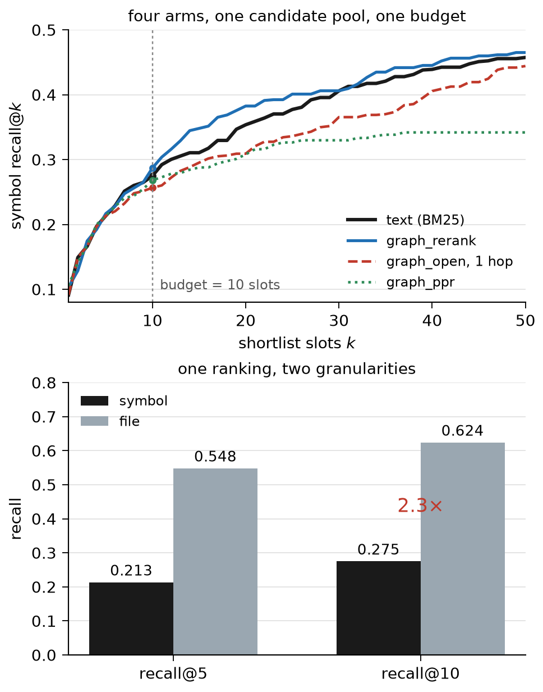

**File-Level Is Not Symbol-Level: Measuring Where Code Graphs Help Repository Agents**

*A 300-task symbol-level benchmark, five graph strategies at equal budget, and the arithmetic that caps them*

## Abstract

Repository-level coding agents are evaluated on whether they resolve an issue, and the retrieval that feeds them is usually reported at file granularity. We measure the other granularity. On 300 SWE-bench Lite tasks across 12 Python repositories we extract the **354 symbols the reference patches actually touch** and ask how often retrieval surfaces them. The same ranking that recovers **62.4%** of gold files at rank 10 recovers **27.5%** of gold symbols: a 2.3× gap that is the real frontier, not an artefact.

We then test five ways of adding a code graph — reranking, slot substitution at one and two hops, score fusion, fusion over only deterministically resolved edges, and personalised PageRank — under an identical candidate pool and character budget. **No graph arm improves symbol-level recall, and three significantly degrade file-level recall.** A one-hop ball is 0.42% gold against 3.1% per text slot, so a graph slot buys a candidate seven times less likely to be right. The gap is a budget, not a granularity: given the right file, ten slots recover 66.5% of gold symbols. Spending five slots in the file a lexical vote prefers, and five on text, gives **0.305** against 0.275 (p = 0.031). We release the benchmark and the harness.

## 1. Introduction

An agent that cannot see a repository must search it: the context holds a few hundred symbols, the repository tens of thousands, and everything downstream depends on the right symbol being among the few.

The literature reports this step mostly at file granularity: LocAgent reports 92.7% file-level accuracy on SWE-bench-style tasks [2]. Those numbers are real and also easy: a large module holds dozens of definitions, and an agent that opens the right file still has to find the one function the fix belongs in.

We measure the fine granularity. For each of 300 SWE-bench Lite tasks we take the reference patch, map every changed line to its enclosing definition, and record the symbols the fix touched. The same ranking that finds 62.4% of gold files at rank 10 finds 27.5% of gold symbols. **The gap is 2.3×, and it is not an artefact — it is one list, scored two ways.**

One instance makes it concrete. `matplotlib__matplotlib-24970` reports NumPy 1.24 deprecation warnings, and its traceback prints the file and the line numbers, so the file is never in doubt: every arm puts `lib/matplotlib/colors.py` in its top five files. Not one puts the definition that has to change — `Colormap.__call__` — in its top ten, though the 200-candidate pool contains it and `__call__` shares no vocabulary with the issue. The file was handed over; the symbol was not.

Second, we test the standard remedy: build a call graph, expand from a strong text hit, let structure carry the rest. We implement five strategies in eight arms, holding everything else fixed. None of the graph arms improves symbol-level recall at ten slots — not even personalised PageRank — and the most aggressive costs 4.8 points of file-level recall (p = 0.004). One arm does gain, and it uses no graph at all (§5).

The explanation is arithmetic. One-hop balls reach a gold symbol in 13% of tasks but are 0.42% gold against 3.1% per text slot, so a graph slot buys a candidate seven times less likely to be right; diffusion converts 44% of what it can reach and still nets −2. Meanwhile 54% of the call sites that would carry the hop resolve to no definite target.

## 2. Related Work

**Repository-level benchmarks.** SWE-bench and its Lite and Verified subsets score whether a patch makes the failing tests pass [1], and say nothing about whether the model could have found the code. Our targets derive from SWE-bench Lite's patches, but symbol-level retrieval is orthogonal to resolved rate and reported as such, not as a proxy.

**Agents over repositories.** SWE-agent fixes the interface and lets the model act [5]; LocAgent navigates with graph structure [2]; ARISE builds a repository graph and lifts Function R@1 from 0.43 to 0.60 [3]. These systems co-design retrieval with a model, so their numbers are not comparable to ours: our retriever is raw BM25 with no model in the loop, so the graph's marginal value is the only thing that varies. ARISE's coverage metric counts gold *lines* in an 8,000-token bundle, not graph coverage.

**Code graphs.** PyCG reports 99.2% precision and 69.9% recall on its own benchmark [4]; CodexGraph turns a repository into a queryable code graph [6], and RepoAtlas maintains evolving repository views for agents [7]. We report the resolution rate of ours — 46% of call sites definite — and the ceiling that bounds what one-hop expansion can contribute.

## 3. Setup

**Tasks.** All 300 instances of SWE-bench Lite, 12 repositories, dominated by django (114) and sympy (77). We fetch each instance's base commit as a tarball (297 distinct commits, 2.5 GB). We never execute the repositories or their tests; the measurement is over source.

**Gold symbols.** For each task we parse the reference patch, and map every changed line to the innermost definition containing it in the *pre-fix* tree: a deleted line anchors itself, an added line anchors the line before it, since the added text does not exist before the fix. The result is 354 definitions over 290 tasks; the other 10 change only module-level statements and contribute no symbol. We record rather than drop the 87 changed lines outside any definition — module-level code, decorators, imports — because a benchmark that discards hard cases reports inflated numbers. A symbol is `<module>.<qualname>`, where the module is the repository-relative path without `.py`, so a patch header and a graph node agree without a lookup table; file-level metrics group the same ranking by file.

**Query and budget.** The issue text as given: no rewrite, no file hints, no LLM preprocessing — the weakest defensible query, so that no improvement can be attributed to query engineering. Every arm fills exactly 10 slots, and we report the characters those ten symbols would add to a prompt, so an arm cannot win by retrieving more.

## 4. Method

**The graph builder.** We build a definition-and-reference graph from source with Python's `ast`, emitting the same JSON shape the competition's released assets use (`nodes[id, name, text]`, `edges[source, target, type, key]`), so one metric applies to both. Nodes are modules, classes, functions and methods, each carrying its signature, docstring, and source span; edges come in four types — `defines`, `imports`, `inherits`, `calls`.

**Resolution states.** What matters is not the edge list but what each edge means. We record seven states and never collapse them:

| state | meaning |
| --- | --- |
| `local` | target defined in the same module |
| `import` | target reached through an import alias |
| `unique` | leaf name occurs exactly once in the repository |
| `suffix` | target matched a dotted suffix (src/ layouts) |
| `external` | stdlib or third-party; not a defect |
| `ambiguous` | more than 64 same-named candidates; refused rather than guessed |
| `unresolved` | no target found |

On a django snapshot (2,715 files, 38,651 nodes, 209,502 edges, 10.8 s) the distribution is 34.1% unresolved, 19.2% local, 15.6% import, 15.0% ambiguous, 11.2% unique, 4.9% external. **Only 46% of call sites resolve to a definite in-repository target** — the quality of the artefact the arms expand, and the reason `graph_fuse_precise` exists.

**The arms.** Eight, all paired by task; `text` is the baseline and the other seven fold in the graph. `text` is BM25 over a document per symbol (path, qualified name, signature, docstring). `graph_rerank` promotes anything one hop from the top five seeds without changing the pool, so it cannot add a candidate. `graph_open` keeps the top five and fills slots 6–10 with their neighbours from the whole graph, padding from text if a seed has none — the only arm that can introduce a symbol BM25 never ranked; its two-hop variant fills from the distance-ordered two-hop ball instead. `graph_fuse` normalises BM25 to its top hit and lets a candidate inherit λ = 0.5 of its best adjacent seed's score, **fixed before the run and never tuned**; `graph_fuse_precise` fuses over only the definite 46%. `graph_ppr` is personalised PageRank — mass starts uniformly on the same five seeds, spreads over the same undirected graph, restarts with probability 0.15 (the convention, not a tuned value), 30 power iterations — and it is the only arm that scores the whole graph rather than a pool; `graph_ppr_text` adds half the diffusion mass to normalised BM25. Neighbours are unioned over `calls` and `inherits`, treated as undirected, and drawn round-robin so a hub cannot absorb the shortlist.

**The file-level arm.** The one arm that ranks files rather than symbols scores each file by its best symbol's BM25 score, by the sum of its top three, and by the IDF-weighted overlap between issue tokens and path tokens; the three rankings are averaged by reciprocal rank — a Borda count with nothing to tune — and five slots go to the winning file, five to the text order.

**Statistics.** Per-task differences, so arms are compared on the same issue and repository: mean difference with a bootstrap 95% interval (2,000 resamples, fixed seed) plus an exact sign test. Ties dominate, so the sign test decides.

## 5. Results

**Coverage is a sanity check, not a finding.** All 354 gold symbols resolve into the graph — expected, since extraction and builder share the `<module>.<qualname>` convention. It shows numerator and denominator agree, nothing more.

**The granularity gap is the headline.** Table 1, one ranking, two ways of scoring it.

*Table 1 — symbol vs file granularity (n = 290 scored tasks)*

| granularity | recall@1 | recall@5 | recall@10 |
| --- | ---: | ---: | ---: |
| symbol | 0.091 | 0.214 | **0.275** |
| file | — | 0.548 | **0.624** |

Line granularity agrees: the ranking covers **23.9%** of the 1,010 changed lines (25.8% of those inside a definition), so the gap is not an artefact of coarse matching.

**At ten slots, no graph arm improves symbol-level recall.** Table 2 and Figure 1.

*Figure 1 — top: symbol recall@k for four of the eight arms over one pool. Bottom: the baseline ranking scored at both granularities. Reranking pulls ahead only past k ≈ 15.*

*Table 2 — the eight arms of §4, paired, equal pool and equal character budget*

| arm | r@1 | r@5 | r@10 | file r@10 | Δr@10 (95% CI) | p |
| --- | ---: | ---: | ---: | ---: | --- | ---: |
| text | 0.091 | 0.214 | 0.275 | 0.624 | — | — |
| graph_rerank | 0.103 | 0.217 | 0.287 | 0.614 | +0.012 (−0.026, 0.050) | 0.50 |
| graph_open, 1 hop | 0.091 | 0.214 | 0.257 | 0.576 | −0.018 (−0.051, 0.013) | 0.46 |
| graph_open, 2 hops | 0.091 | 0.214 | 0.249 | 0.579 | −0.026 (−0.057, 0.003) | 0.18 |
| graph_fuse | 0.091 | 0.217 | 0.272 | 0.624 | −0.003 (−0.010, 0.000) | 1.00 |
| graph_fuse_precise | 0.091 | 0.217 | 0.275 | 0.624 | 0.000 | 1.00 |
| graph_ppr | **0.106** | 0.214 | 0.268 | 0.579 | −0.007 (−0.040, 0.027) | 0.72 |
| graph_ppr_text | 0.091 | 0.217 | 0.272 | 0.624 | −0.003 (−0.010, 0.000) | 1.00 |

The second-hop variant has the most reach (35.7%, Table 3) and is still negative. Fusion at a principled weight is nearly the identity.

Reranking survives a wider budget: +2.9 points at k = 20 (13 wins, 3 losses, p = 0.021), +0.8 at k = 50 (p = 0.45). It reorders a pool it cannot enlarge, so the benefit arrives only once there are enough slots for a promoted symbol to land inside the cut.

**Diffusion is a lateral move, not a win.** Personalised PageRank is the only arm that improves the first slot (0.106 against 0.091), and its deficit can be audited: it finds 15 gold symbols text misses and drops 17 text had. At file level it loses 4.5 points (7 wins, 20 losses, p = 0.019). Sharpening rank one while losing the file is a bad trade.

**Expansion is significantly worse at file granularity.** `graph_open` trades slots 6–10 for neighbours: 18 tasks lose a gold file, 4 gain one, mean −4.8 points (p = 0.004), and the two-hop arm repeats it (−4.5, p = 0.011).

**Reach bounds the arm; the exchange rate eats the bound.** Table 3.

*Table 3 — diagnostics, ceilings and the ablation grid (n = 290)*

| quantity | value | meaning |
| --- | ---: | --- |
| pool recall, top 60 / 200 / 500 | 0.464 / 0.600 / 0.704 | candidate generation keeps improving with pool size |
| reach, 1 hop, 1 / 3 / 5 / 10 seeds | 0.038 / 0.089 / 0.119 / 0.118 | tasks with a gold symbol adjacent to a seed |
| reach, 2 hops, 1 / 3 / 5 / 10 seeds | 0.191 / 0.310 / 0.357 / 0.395 | radius buys reach quickly |
| one-hop ball, median size / gold density | 21 nodes / 0.42% | 41 gold symbols among 9,855 neighbours |
| diffusion's conversion of the ball | 18 / 41 (44%) | reachable gold placed in its top 10 |
| oracle@10, pool only / pool plus neighbours | 0.600 / 0.630 | a perfect reranker's ceiling, with and without expansion |
| symbol exchange at k = 10, ppr | +15 gained, −17 lost | the arm's net is a wash |
| tasks whose gold symbols never enter the top-500 pool | 80 / 290 (27.6%) | the hard tail |

One-hop expansion has an arithmetic ceiling: 38 of 290 tasks (13.1%; 41 of 354 symbols) have a gold symbol one hop from a top-five seed, so the arm can gain at most 11.9 points even at perfect conversion. Two hops lift the ceiling to 35.7% (111 tasks, 125 symbols), which is why the radius sweep looks promising.

Conversion is not the failure. Diffusion places 18 of the 41 reachable symbols in its top ten — 44%, median rank 12 — and still lands below text, because 15 gained cost 17 lost. The rate is the finding: 9,855 neighbours hold 41 answers, 0.42%, against 3.1% gold per text slot. A graph slot buys a candidate seven times less likely to be right, so the graph must out-rank text by that factor merely to break even — and diffusion breaks exactly even.

**Where the gap is.** Spending all ten slots inside the top k files never beats text (best −0.007, p = 1.00), but it decomposes the gap: recall@10 ≈ P(gold file selected) × E[recovered | depth], and the product is 0.222 / 0.268 / 0.257 / 0.241 / 0.275 for one, two, three, five files and full breadth. Given the *right* file, ten slots recover **66.5%** of gold symbols, 2.4× the baseline: what is missing is file precision at small k, not symbol ranking.

**One arm gains, and it is not a graph arm.** A parameter-free vote over three lexical file scores — best symbol, sum of the top three, issue-to-path match — names the gold file first 34.5% of the time against 29.0%. Five slots in that file and five on text reach **0.305** against 0.275 (14 wins, 4 losses, p = 0.031, 36 fewer characters). The split was fixed before the run; a post-hoc sweep moves the answer only between 0.287 and 0.305, significant at three to five slots (p = 0.016–0.039), so the choice is not load-bearing. Adding file-level PageRank gives 0.300. Many arms were run, so we report this as a direction.

**Where the graph helps.** Astropy is the one repository with a clear gain (0.458 → 0.792, six tasks); five repositories have zero one-hop reach and can only lose. With only 46% of edges definite, restricting expansion to the definite subgraph does not help either — structural, not noise.

**Reproducibility.** Each number here is re-derived from the released JSONL by a 70-assertion check script, so a claim that drifts from the data fails the build rather than the review.

## 6. Discussion

The practical claim is a reprioritisation. One-hop expansion is not where the error is: 88.1% of gold symbols are more than one hop from a strong text seed, half the call sites that would carry the hop do not resolve, and the exchange rate is seven to one against. The margin is in file-level aggregation, and in candidate generation for the 27.6% of tasks whose gold never enters a top-500 pool.

The measurement claim is about granularity. File-level numbers near 90% are quoted as evidence that the hard part is over; the same ranking is 62.4% on files and 27.5% on symbols — a different task, not a tighter definition of success.

One thing would not overturn it: a stronger reranker over the same pool. A perfect text reranker reaches 0.600 and a perfect reranker over pool plus neighbours 0.630, so the graph's entire headroom is three points. What would overturn it is a different pool — a retriever that draws candidates by meaning rather than by name — or a graph built by type inference, since PyCG reports 99.2% precision at 69.9% recall [4] and our 46% is a property of the builder. Both replace a component we held fixed.

## 7. Limitations

Python only, though so are most benchmark tasks we compare against. One retriever: BM25, with no dense retriever or cross-encoder, so the result is about the graph's marginal value *given this ranking*, not about graphs in general. Diffusion's restart probability and the fusion weight were fixed at conventional values, not tuned. We measure retrieval, not resolution: a better shortlist is necessary for a better patch, not sufficient.

## 8. Conclusion

Same ranking, two granularities: 62.4% of gold files, 27.5% of gold symbols. Eight graph arms, none of which improves symbol-level recall and three of which significantly hurt file-level recall. The arithmetic that explains it — an 11.9-point reach ceiling, a ball that is 0.42% gold against 3.1% for a text slot, and 66.5% recovery once the file is known — says where the next slot should go: to file precision, not to graph expansion. The one arm that gains does exactly that (0.305, p = 0.031).

## References

[1] Jimenez et al. SWE-bench: Can Language Models Resolve Real-World GitHub Issues? ICLR 2024.

[2] Chen et al. LocAgent: Graph-Guided LLM Agents for Code Localization. 2025.

[3] Seddik et al. ARISE: A Repository-level Graph Representation and Toolset for Agentic Program Repair and Fault Localization. 2026.

[4] Salis et al. PyCG: Practical Call Graph Generation in Python. ICSE 2021.

[5] Yang et al. SWE-agent: Agent-Computer Interfaces Enable Automated Software Engineering. NeurIPS 2024.

[6] Liu et al. CodexGraph: Bridging Large Language Models and Code Repositories via Code Graph Databases. NAACL 2025.

[7] Zhang et al. RepoAtlas: Guiding Coding Agents via Evolving Multimodal Repository Views. 2026.
