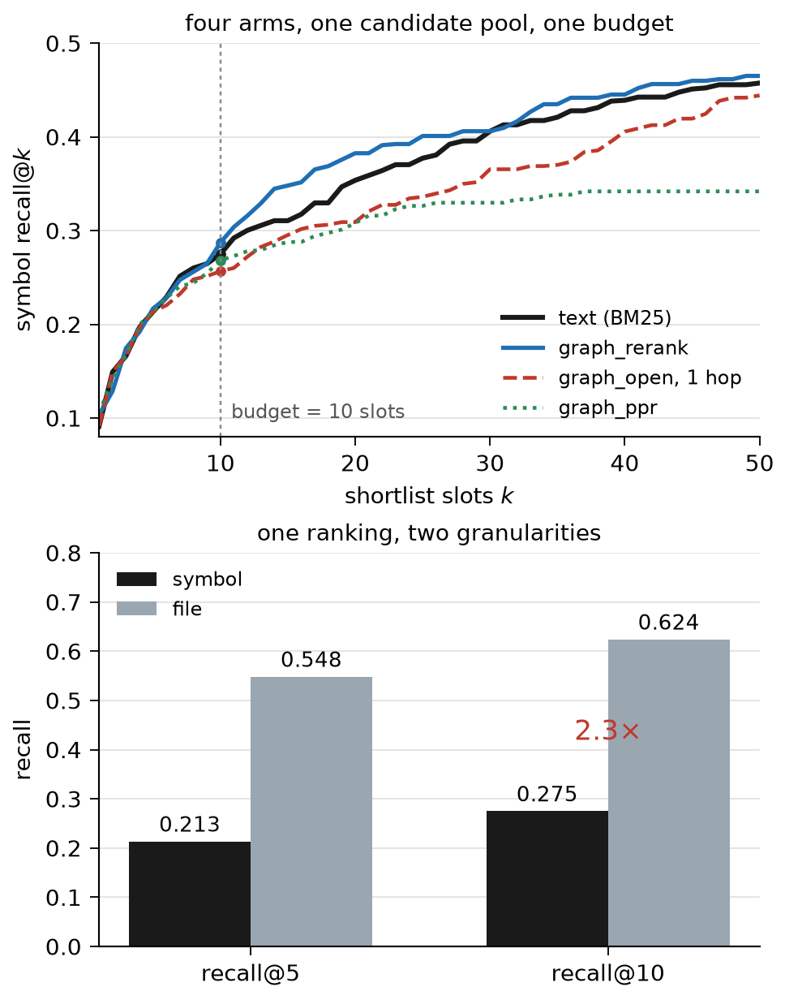

**Beyond File Hits: Candidate Coverage and Graph Utility in Code Localization**

*A controlled retrieval study of graph reach, shortlist displacement, and index content on SWE-bench Lite and the full test split*

## Abstract

File-level localization can hide missed definitions, but graph utility also depends on the comparison. We audit patch-derived targets and separate candidate coverage, shortlist selection, and topology controls. On 290 scorable SWE-bench Lite tasks, one ranking recovers **62.4%** of gold files but **27.5%** of gold symbols at ten slots. Graph reranking gains **2.2 points** on 2,232 tasks. A follow-up holds candidate pools fixed and compares real edges with degree- and file-constrained rewiring under metadata, body, and dense rankings. Real graphs outperform rewiring by **2.14, 0.90, and 1.76 points**, respectively; metadata and dense contrasts survive repository-level testing with Holm correction. Yet gains over the original rankings are **2.19, −0.01, and 0.64 points**: topology signal and useful intervention differ. Representation interactions do not survive correction. A learned ranker plus dense scores reaches **44.7%** symbol and **72.7%** file recall. We release targets, graph controls, rankings, and audits. Results characterize static, fixed-slot retrieval, not general graph-guided agent effectiveness.

## 1. Introduction

A file hit leaves code to inspect: Lite gold files contain a median 48 definitions, and the median file/definition length ratio is 16.1. Prior work evaluates functions and graph tools [2,3,11]; we investigate how candidate coverage and shortlist replacement mediate retrieval outcomes.

Our question is narrower: **when a graph changes a fixed-length shortlist, does it recover missing targets or displace targets already retrieved?** We separate three observable quantities: coverage of the candidate pool, selection within that pool, and hits credited at file versus symbol level. The same ten symbol slots recover 62.4% of files and 27.5% of symbols, a 2.3× ratio; this is a property of this ranking and metric, not a universal difficulty multiplier.

Two cases distinguish ranking from candidate-generation failure. In the original eight-arm Lite experiment, all arms find the reference file for `matplotlib__matplotlib-24970`, but none ranks `Colormap.__call__` in the top ten despite its presence in the pool. Separately, 80 of 290 scorable Lite tasks have no reference-patch target in a 500-candidate pool. Reranking may address the first failure; the second requires changing the candidate set.

Our contribution is an audited empirical decomposition: controlled graph interventions with reach and displacement accounting; a scale extension showing which small-sample findings persist; and constrained topology controls across three input representations. These distinguish a graph carrying signal from a reranking policy improving retrieval.

## 2. Related Work

**Localization and repair.** SWE-bench evaluates patches [1]; SWE-agent studies agent interfaces [5]. LocAgent evaluates multiple localization granularities and graph tools [2], while ARISE reports function and line localization alongside repair [3]. Their agent results cannot be compared numerically with our static retrieval recall.

**Closest graph study.** Bellam [11] ablates grep, embedding, and graph tools across small coding agents, stratifies tasks by graph depth, and measures downstream repair. Our complementary scope is the retrieval layer: fixed-slot target displacement, candidate ceilings, degree/file-matched topology controls across retrieval representations, and an independently audited answer key.

**Retrieval representations.** CORE-Bench [8], RepoNav [9], and FuseSearch [10] study repository retrieval and navigation. PyCG [4] evaluates call-graph construction; CodexGraph [6] and RepoAtlas [7] expose repository structure to agents. Our graph resolution rate describes one implementation, not the quality of these systems.

## 3. Setup

**Tasks.** Lite has 300 instances across 12 Python repositories, dominated by django (114) and sympy (77), with 297 base commits. The full test split has 2,294 tasks; 2,232 are scorable and 62 lack resolvable gold symbols. Lite is contained in this split, so the larger study is a scale extension, not independent replication. We measure source retrieval without executing patches.

**Gold symbols.** For each task we parse the reference patch and map every changed line to the innermost definition containing it in the *pre-fix* tree: a deleted line anchors itself, an added line the line before it, since the added text does not exist before the fix. That gives 354 definitions over 290 tasks; the other 10 are dropped: 2 change only module-level lines, 8 only add definitions. We separately record 87 changed lines outside definitions; symbol recall excludes these lines and the ten empty-gold tasks. A symbol is `<module>.<qualname>`, module being the file path without `.py`; file-level metrics group the same ranking by file. A second implementation reproduces 279 of 300 keys; rescoring moves recall by at most 0.7 points.

**Query and budget.** Lexical and graph arms use the issue text without rewriting. We compare ten symbol slots, not equal token or character counts. File recall groups these same ten symbols by file; it is not retrieval of ten distinct files. BM25 starts from 200 candidates; graph expansion and diffusion can search outside that pool. The 500-candidate diagnostic is separate.

## 4. Method

**The graph builder.** We build a definition-and-reference graph from source with Python's `ast`, in the same JSON shape as the competition's released assets, so one metric applies to both. Nodes are modules, classes, functions and methods, each carrying its signature, docstring, and source span; edges come in four types — `defines`, `imports`, `inherits`, `calls`.

**Resolution.** Calls are classified as local, imported, unique-name, suffix-matched, external, ambiguous, or unresolved. On one django snapshot, **46%** resolve to a definite in-repository target. This is a resolution diagnostic, not measured edge precision.

**The arms.** BM25 indexes each symbol's path, qualified name, signature, and docstring. Seven graph variants intervene on its ranking: one-hop reranking from five seeds; one- and two-hop expansion replacing slots 6-10; score fusion with lambda = 0.5; fusion restricted to definite edges; personalised PageRank (restart 0.15); and PPR mixed with normalised BM25. Reranking stays in the lexical pool; expansion and PPR can reach outside it. Call and inheritance neighbours are undirected and round-robin expansion limits hub dominance. Parameters are fixed across tasks.

**Two more rankings.** The evidence arm reads what the issue states: a traceback frame resolves through the same symbol table we built, a named path is a suffix match, and a quoted line is found by indexing the candidate's *body* — text our symbol documents never contain. The learned arm puts sixteen signals into one ranker (§5).

**Historical-arm statistics.** Paired task differences: mean difference with a bootstrap 95% interval (2,000 resamples, fixed seed) plus an exact sign test. Follow-up inference is specified with Table 8.

**Null-derived denoiser.** We treat real edges removed by rewiring as positives and added edges as negatives, train on six repositories, and filter seed neighbours on held-out repositories without repair labels.

## 5. Results

**Scoring granularity.** Table 1 scores one ranking two ways; all 354 gold symbols resolve into the graph.

*Table 1 — symbol vs file granularity (n = 290 scored tasks)*

| granularity | recall@1 | recall@5 | recall@10 |
| --- | ---: | ---: | ---: |
| symbol | 0.091 | 0.214 | **0.275** |
| file | — | 0.548 | **0.624** |

Line granularity agrees: the ranking covers **23.9%** of the 1,010 changed lines, so the gap is not a matching artefact. **No graph variant has a statistically significant symbol improvement on Lite at ten slots** — Table 2 and Figure 1.

**Source size.** Median gold-file and touched-definition lengths are 28,950 and 1,726 characters; 112 tasks exceed a 25× ratio. These lengths do not establish token, latency, or repair savings.

*Figure 1 — top: symbol recall@k for BM25, the best graph arm, the learned ranker and the ranker with evidence. Bottom left: the same ranking by file and by symbol. Bottom right: the ranker's gain over BM25 by what the issue offers, at both scales.*

*Table 2 — BM25 and seven graph variants, paired at ten symbol slots; candidate access differs*

| arm | r@1 | r@5 | r@10 | file r@10 | Δr@10 (95% CI) | p |
| --- | ---: | ---: | ---: | ---: | --- | ---: |
| text | 0.091 | 0.214 | 0.275 | 0.624 | — | — |
| graph_rerank | 0.103 | 0.217 | 0.287 | 0.614 | +0.012 (−0.026, 0.050) | 0.50 |
| graph_open, 1 hop | 0.091 | 0.214 | 0.257 | 0.576 | −0.018 (−0.051, 0.013) | 0.46 |
| graph_open, 2 hops | 0.091 | 0.214 | 0.249 | 0.579 | −0.026 (−0.057, 0.003) | 0.18 |
| graph_fuse | 0.091 | 0.217 | 0.272 | 0.624 | −0.003 (−0.010, 0.000) | 1.00 |
| graph_fuse_precise | 0.091 | 0.217 | 0.275 | 0.624 | 0.000 | 1.00 |
| graph_ppr | **0.106** | 0.214 | 0.268 | 0.579 | −0.007 (−0.040, 0.027) | 0.72 |
| graph_ppr_text | 0.091 | 0.217 | 0.272 | 0.624 | −0.003 (−0.010, 0.000) | 1.00 |

Second-hop reach increases to 35.7% without a recall gain. Reranking gains +2.9 at k = 20 (p = 0.021).

**Displacement can offset reach.** Personalised PageRank wins the first slot (0.106 against 0.091) and still trades 15 gained gold symbols for 17 lost; at file level it loses 4.5 points (p = 0.019). `graph_open` swaps slots 6–10 for neighbours: 18 tasks lose a gold file, 4 gain one, −4.8 points (p = 0.004). **Reachable targets do not guarantee net gains** — Table 3.

*Table 3 — candidate coverage and displacement diagnostics (n = 290)*

| quantity | value | meaning |
| --- | ---: | --- |
| reach, 2 hops, 1 / 3 / 5 / 10 seeds | 0.191 / 0.310 / 0.357 / 0.395 | radius buys reach quickly |
| one-hop ball, median size / gold density | 21 nodes / 0.42% | 41 gold symbols among 9,855 neighbours |
| diffusion's conversion of the ball | 18 / 41 (44%) | reachable gold placed in its top 10 |
| oracle@10, pool only / pool plus neighbours | 0.600 / 0.630 | a perfect reranker's ceiling, with and without expansion |
| tasks whose gold symbols never enter the top-500 pool | 80 / 290 (27.6%) | the hard tail |

One-hop reach covers 41 of 354 symbols across 38 tasks, or **11.9%** macro recall before overlap and displacement. PPR retrieves 18 of those 41 (44%), but its 15 new gold hits cost 17 existing hits. The 9,855 neighbours are **0.42%** gold versus **3.1%** per text slot: reach alone is a poor guide to replacement.

**Within-file selection.** Given oracle gold files, ten slots recover **66.5%** of gold symbols.

**A learned ranker.** Sixteen lexical, issue-evidence, graph, and size features feed LightGBM. We sort the 12 repositories, split alternating entries into two groups of six, then train and test in both directions. Each task is evaluated once on unseen repositories; predictions average three seeds. This is repository-held-out two-fold evaluation. Hyperparameters are fixed across folds; exploratory method selection limits claims of an untouched test set.

*Table 4 — learned ranking and evidence (n = 290)*

| ranking | r@10 | Δ vs BM25 | W/L | p |
| --- | ---: | ---: | --- | ---: |
| BM25 | 0.275 | — | — | — |
| learned ranker, 16 features | 0.332 | +0.057 (0.019, 0.096) | 31/14 | 0.016 |
| + evidence, 5 slots | **0.361** | **+0.086 (0.046, 0.126)** | **39/13** | **<0.001** |

**Full-scale ranking.** A frozen 33M bge-small-en-v1.5 encoder scores the same 200 candidates. It embeds the issue's first 1,200 characters and each candidate's path, name, and first 800 body characters, using CLS pooling, cosine similarity, and a 512-token cap. Adding this score to the sixteen features gives +8.6 points (418 wins, 83 losses).

*Table 5 — full-scale recall@10 (n = 2,232); all learned predictions are held out by repository*

| ranking | symbol | file |
| --- | ---: | ---: |
| BM25 | 0.248 | 0.564 |
| graph rerank | 0.270 | 0.564 |
| 16-feature ranker | 0.361 | 0.643 |
| dense score alone | 0.366 | 0.693 |
| ranker + dense score | **0.447** | **0.727** |

The file/symbol ratio falls from 2.28× to 1.63×. Dense scoring also reads body text, so this comparison does not isolate pretraining from input representation.

*Table 6 — the ranker split by what the issue offers, at both scales (left 290 tasks, right 2,232)*

| subset | n | BM25 | ranker | n | BM25 | ranker |
| --- | ---: | ---: | ---: | ---: | ---: | ---: |
| quotes the gold body | 54 | 0.481 | **0.776** | 355 | 0.459 | **0.755** |
| names a path or a frame | 16 | 0.406 | 0.469 | 224 | 0.380 | **0.659** |
| neither | 220 | 0.215 | 0.214 | 1,653 | 0.185 | 0.236 |

On tasks whose issue pastes a line from the gold body the ranker gains **29.4 points at 290 tasks and 29.6 at 2,232**. The middle bucket: naming a file or a frame looked worth 6 points on sixteen tasks and 27.8 on 224. Explicit issue evidence predicts larger gains; Table 7 also shows a positive contribution from graph features.

**Scale extension.** Table 7 uses the same metric definition on 2,232 scorable tasks from 2,174 snapshots. Training-set size also increases for learned arms.

*Table 7 — what survives a 7.7× larger sample*

| reading | 290 tasks | 2,232 tasks |
| --- | --- | --- |
| file / symbol recall@10 | 0.624 / 0.275 = 2.27× | 0.564 / 0.248 = **2.28×** |
| graph rerank, symbol | +0.012 (−0.026, 0.050) | +0.022 (0.013, 0.031) |
| graph rerank, file | −0.010 | +0.000 (−0.009, 0.008) |
| learned ranker, symbol | +0.057 | +0.113 (0.098, 0.128) |
| learned ranker, file | — | 0.564 → 0.643 |
| graph features, with − without | −0.017, p = 0.50 | +0.027 (0.017, 0.036) |
| evidence override over the ranker | +0.029, p = 0.035 | −0.002 (−0.008, 0.004) |

The BM25 ratio is similar across scales, **2.27× versus 2.28×**. Graph reranking gains +0.022 on symbols (169 wins, 90 losses; positive in 8 of 12 repositories). Its file effect is +0.000 with CI (−0.009, 0.008), compatible with small positive or negative effects. Graph features add +0.027 inside the learned ranker. The evidence override's Lite gain does not persist at full scale: −0.002. Sample composition and additional training data both change, so this comparison alone cannot identify why.

**What you index moves the gap.** Adding the candidate's body raises symbol recall at 2,232 tasks from 0.248 to 0.286 (+3.8, CI 2.1–5.4): the gap narrows from 2.28× to 1.97×. Another symbol's body instead drops recall to 0.128, so the gain is the candidate's own text; as two ranker columns it is worth **+2.6 points** (202/94).

**Topology versus intervention.** A follow-up fixes the original candidate pool and compares metadata, body-inclusive BM25, and frozen dense orders. We retain five seeds, promote one-hop neighbours in the remaining slots, and compare real edges with same-file promotion and constrained rewiring. This matches full-scale reranking; historical Lite arms could move seeds. Body scores use whole-repository corpus statistics. Dense retains saved score order; historical rounded-score tie handling changes one task's base recall, without changing the inference.

Each randomized graph preserves every candidate's within-file and cross-file degree; a stricter variant also preserves its degree to each partner file. Five fixed random seeds use 20 attempted swaps per edge, with invariants checked. Random outcomes are averaged within task. Five planned contrasts—real minus rewired under each representation, and two interactions against metadata—use exhaustive repository sign flips and Holm correction; intervals use 10,000 repository-cluster resamples. Protocol and input hashes were fixed before new outcome inspection.

*Table 8 — follow-up symbol recall@10 on 2,232 tasks; p tests real minus rewired with Holm correction*

| base representation | base | real | same-file | rewired | file-pair rewired | p |
| --- | ---: | ---: | ---: | ---: | ---: | ---: |
| metadata | 0.2479 | 0.2698 | 0.2534 | 0.2484 | 0.2612 | 0.0137 |
| body | 0.3171 | 0.3170 | 0.3295 | 0.3080 | 0.3128 | 0.1787 |
| dense | 0.3659 | 0.3723 | 0.3645 | 0.3547 | 0.3658 | 0.0049 |

Real-minus-rewired effects are +2.14 (CI 1.34–2.66), +0.90 (0.01–1.58), and +1.76 (1.04–2.82) points. The body and dense interactions are −1.24 and −0.38 points (Holm p = 0.126 and 0.598): neither establishes attenuation. Real-minus-base effects are +2.19, −0.01, and +0.64 points; the dense secondary repository test has p = 0.069. Thus rejecting a randomized topology does not establish a useful improvement over dense retrieval.

The primary null replaces 54.2% of edges; 28 graphs accept no swap. The stricter null replaces 19.0%; 273 are immobile. The exploratory denoiser raises body recall from 0.3171 to 0.3195, but its repository interval crosses zero; metadata and dense variants trail unfiltered real promotion. Thus null controls provide algorithmic supervision, not yet robust selection gains.

**Reproducibility.** We release per-task rankings, labels, and audits (`tools/audit_numbers.py`; `tools/audit_counterfactual_topology.py`), with protocols in `docs/reproduction.md` and `docs/graph-control-protocol.md`. Auditing saved outputs is distinct from rerunning retrieval and training.

## 6. Discussion

Reranking changes selection inside a pool; expansion can add targets but displace existing hits. On Lite, the 200-candidate oracle reaches 0.600, rising to 0.630 with neighbours. These are candidate-set ceilings, not universal graph limits. Among 80 tasks missed by a 500-candidate pool, only 12 contain our detected exact cues. Absence of these cues does not imply absence of semantic evidence.

The follow-up separates **structural signal from intervention value**. Real topology beats a degree/file-constrained null under metadata and dense ranking, yet its fixed promotion rule adds little over body or dense retrieval. Stronger inputs also leave less unfilled oracle headroom; the interaction does not isolate an information-substitution mechanism. The results support topology-sensitive diagnostics, not a claim that better text makes graphs redundant.

## 7. Limitations

Python only; one heuristic static graph; no equal-token comparison or downstream repair evaluation. The eight-arm study uses metadata BM25, while only graph reranking is repeated at full scale. Multi-turn graph navigation and type-aware graphs are outside scope. Reference-patch symbols are one repair's targets, not all valid solutions; new definitions and module-level changes require different metrics. Issue-evidence buckets use gold for retrospective analysis, not deployable routing. Lite is nested in the full split; method development reused this benchmark. Historical task-level inference omits repository dependence; follow-up tests address clustering but assume symmetric repository effects under the null. Constrained swaps are not proven uniformly sampled or mixed. These limits constrain generalization to other retrievers and agents.

## 8. Conclusion

Fixed-slot retrieval can credit files while missing edited definitions. Our audit diagnoses candidate coverage and displacement. Matched topology controls reveal signal under metadata and dense rankings, but signal does not guarantee improvement from a simple reranking policy. Representation interactions remain inconclusive after correction. The contribution is a reproducible diagnosis with explicit controls and limits; learned feature/dense fusion reaches 44.7% symbol and 72.7% file recall.

## References

[1] Jimenez et al. SWE-bench: Can Language Models Resolve Real-World GitHub Issues? ICLR 2024.

[2] Chen et al. LocAgent: Graph-Guided LLM Agents for Code Localization. 2025.

[3] Seddik et al. ARISE: A Repository-level Graph Representation and Toolset for Agentic Program Repair and Fault Localization. 2026.

[4] Salis et al. PyCG: Practical Call Graph Generation in Python. ICSE 2021.

[5] Yang et al. SWE-agent: Agent-Computer Interfaces Enable Automated Software Engineering. NeurIPS 2024.

[6] Liu et al. CodexGraph: Bridging Large Language Models and Code Repositories via Code Graph Databases. NAACL 2025.

[7] Zhang et al. RepoAtlas: Guiding Coding Agents via Evolving Multimodal Repository Views. 2026.

[8] Zhang et al. CORE-Bench: A Comprehensive Benchmark for Code Retrieval in the Era of Agentic Coding. EMNLP 2026.

[9] Chai et al. RepoNav: From Snippet Retrieval to File-Centered Repository Navigation for Code Agents. EMNLP 2026.

[10] FuseSearch: Learning Adaptive Parallel Execution for Efficient Code Localization. ACL 2026 Findings.

[11] Saurav Bellam. How Do Small Coding Agents Use Code Graphs and Embeddings? arXiv:2610.33958, 2026.
